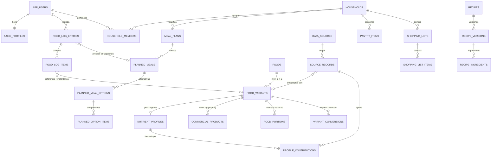

# Entregable F · Modelo de datos Oracle

> Estado: **implementado y probado** en Oracle AI Database 26ai Free (release 23.26.4) mediante Flyway OSS 13.12.2: 9 migraciones versionadas + 1 repetible aplicadas desde cero, 19 pruebas de humo superadas, migración idempotente. Lo que **no** está hecho se lista en §9. Código: [`database/`](../../database/).

## 1. Cifras (medidas en la BD real)

70 tablas · 239 índices · 798 restricciones (incluye NOT NULL y CHECK) · 13 disparadores · 1 secuencia propia (`SYNC_SEQ_GEN`) + identidades.

## 2. Convenciones (propias de FITona)

| Tema | Regla |
|---|---|
| Idioma | Identificadores en **inglés**, MAYÚSCULAS, `snake` con `_`; textos visibles al usuario en i18n (columnas `NAME_ES` solo en datos de referencia) |
| Claves de datos personales | `RAW(16)` (UUID) **generado en el cliente** ⇒ creación offline sin colisiones |
| Claves de catálogo/referencia | `NUMBER` con `GENERATED BY DEFAULT ON NULL AS IDENTITY` o códigos naturales (`ALLERGENS.CODE`) |
| Fechas | `TIMESTAMP(6) WITH TIME ZONE` para instantes; `DATE` para días calendario (`EATEN_ON`) |
| Booleanos | `BOOLEAN` nativo de Oracle 23ai; JSON con tipo `JSON` |
| Texto | `VARCHAR2(n CHAR)` |
| Nombres de restricciones | `PK_`, `FK_`, `UK_`, `CK_`, índices `IX_`/`UX_` |
| Toda FK tiene índice | Verificado automáticamente (prueba de humo) |
| Documentación | `COMMENT ON TABLE` en las 70 tablas (verificado) |
| Fiabilidad | Dato nulo = **desconocido**, nunca 0; sin fila de alérgeno = **desconocido**, nunca «libre de» |

> Estas convenciones son las de FITona. No se reutilizan las de otros proyectos.

## 3. Mapa por dominio (70 tablas)

| Dominio | Tablas |
|---|---|
| Referencia (10) | `ALLERGENS`, `PORTION_UNITS`, `PORTION_UNIT_NAMES`, `SHOPPING_SECTIONS`, `FOOD_CATEGORIES`, `NUTRIENT_DEFINITIONS`, `DATA_SOURCES`, `ACTIVITY_TYPES`, `TAG_DEFINITIONS`, `STORES` |
| Identidad y perfil (10) | `APP_USERS`, `USER_PROFILES`, `USER_GOAL_INTENTS`, `USER_CONSENTS`, `USER_ALLERGENS`, `USER_APPLIANCES`, `NUTRITION_TARGETS`, `HOUSEHOLDS`, `HOUSEHOLD_MEMBERS`, `HOUSEHOLD_INVITATIONS` |
| Catálogo (15) | `CATALOG_RELEASES`, `IMPORT_BATCHES`, `NUTRIENT_PROFILES`, `PROFILE_NUTRIENTS`, `FOODS`, `FOOD_VARIANTS`, `FOOD_NAMES`, `FOOD_PORTIONS`, `VARIANT_CONVERSIONS`, `COMMERCIAL_PRODUCTS`, `SOURCE_RECORDS`, `PROFILE_CONTRIBUTIONS`, `ALLERGEN_DECLARATIONS`, `CATALOG_REVIEW_ITEMS`, `USER_FOOD_USAGE` |
| Recetas (7) | `RECIPES`, `RECIPE_VERSIONS`, `RECIPE_INGREDIENTS`, `RECIPE_STEPS`, `RECIPE_TAGS`, `RECIPE_SHARES`, `RECIPE_USER_STATES` |
| Despensa, compra, precios (7) | `PREPARED_BATCHES`, `PANTRY_ITEMS`, `SHOPPING_LISTS`, `SHOPPING_LIST_ITEMS`, `HOUSEHOLD_STORE_LAYOUTS`, `PRICE_OBSERVATIONS`, `SHARE_LINKS` |
| Plan y diario (9) | `MEAL_PLANS`, `PLANNED_MEALS`, `PLANNED_MEAL_OPTIONS`, `PLANNED_OPTION_ITEMS`, `FOOD_LOG_ENTRIES`, `FOOD_LOG_ITEMS`, `SAVED_MEALS`, `SAVED_MEAL_ITEMS`, `FOOD_FEEDBACK` |
| Actividad y bienestar (4) | `ACTIVITY_LOGS`, `USER_INTEGRATIONS`, `WELLBEING_ENTRIES`, `BODY_MEASUREMENTS` |
| IA y operación (8) | `ASSISTANT_MEMORIES`, `AI_ACTION_PROPOSALS`, `AI_USAGE_EVENTS`, `USER_ENTITLEMENTS`, `IDEMPOTENCY_KEYS`, `USER_DATA_REQUESTS`, `AUDIT_EVENTS`, `APP_SETTINGS` |

Se han evitado tablas por concepto cuando una tabla con restricción lo cubre (p. ej. una sola `NUTRIENT_PROFILES` para observaciones de fuente, perfiles representativos, personalizados y de etiqueta; una sola `FOODS` para genéricos y alimentos privados del usuario con `OWNER_USER_ID`).

## 4. Diagrama (núcleo)

## 5. Decisiones de diseño clave

1. **Tres niveles de catálogo** (`FOODS` → `FOOD_VARIANTS` → `COMMERCIAL_PRODUCTS`). Una variante solo existe si cambia lo nutricional (crudo/cocido, con/sin azúcar). `FOOD_VARIANTS.ATTRIBUTES` (JSON) guarda los discriminantes que el motor de agrupación usa para **no** fusionar productos «parecidos». Índice único parcial: una sola variante por defecto por alimento.
2. **Perfiles nutricionales inmutables.** Un perfil `APPROVED` no puede cambiar sus valores (disparador `TRG_NUTRIENT_PROFILES_IMMUTABLE`, probado): se crea otro y se enlaza `SUPERSEDED_BY_ID`. Las restricciones CHECK rechazan lo físicamente imposible (macros > 100 g/100 g, azúcares > hidratos, kcal > 900); lo *sospechoso* pero posible lo marca el importador en `CATALOG_REVIEW_ITEMS`.
3. **Histórico a salvo.** `FOOD_LOG_ITEMS` guarda **instantánea** de nutrientes + `NUTRIENT_PROFILE_ID` + `CATALOG_RELEASE_ID`: si el catálogo cambia, lo ya registrado no. `DATA_QUALITY` (`VERIFIED`/`AVERAGE`/`ESTIMATE`/`CUSTOM`/`NONE`), rango de incertidumbre (`ENERGY_KCAL_LOW/HIGH`) y CHECK: un registro `FREE_TEXT` **no puede** llevar kcal inventadas.
4. **Plan ≠ diario.** `PLANNED_MEALS.STATUS` (`PLANNED/DONE/REPLACED/SKIPPED`) y `FOOD_LOG_ENTRIES.PLANNED_MEAL_ID` opcional. Cambiar uno nunca reescribe el otro. `PLANNED_MEAL_OPTIONS` modela «plan alternativo»; `PLANNED_OPTION_ITEMS` guarda ajustes «solo esta vez» sin tocar la receta.
5. **Recetas versionadas.** Editar crea `RECIPE_VERSIONS` nueva; planes y registros antiguos siguen apuntando a su versión. La nutrición por ración se calcula en el motor y se guarda con su completitud (`COMPLETE/PARTIAL/NONE`).
6. **Seguridad alimentaria sin invención.** `FRIDGE_DAYS_MAX` solo admite valor con `STORAGE_SOURCE_ID` (CHECK probado); en `PREPARED_BATCHES`, la fecha límite exige origen `USER` o `GUIDANCE` con fuente. Las fechas de caducidad de `PANTRY_ITEMS` solo las introduce la persona.
7. **Alérgenos.** `ALLERGEN_DECLARATIONS`: sin fila = desconocido. Los 14 alérgenos del anexo II del Reglamento 1169/2011 están cargados.
8. **Precios con procedencia.** `PRICE_OBSERVATIONS.PRICE_KIND` (`VERIFIED/IMPORTED/RECEIPT/MANUAL/ESTIMATE`): los precios de ticket/manuales exigen propietaria (privados); los `VERIFIED/IMPORTED` exigen fuente (probado). Módulo independiente del catálogo nutricional.
9. **Licencias por fuente.** `DATA_SOURCES.COMMERCIAL_USE`/`SHARE_ALIKE`: BEDCA cargada como `NO` (requiere autorización de AESAN para uso comercial, ver investigación), Open Food Facts como `YES` + share-alike (capa aislada), CIQUAL `UNKNOWN` hasta confirmar la versión vigente. **Ninguna fuente `NO`/`UNKNOWN` debe publicarse** en `CATALOG_RELEASES`.
10. **Privacidad y aislamiento.** `APP_USERS` sin correo ni contraseña; todo dato personal cuelga de `USER_ID` o `HOUSEHOLD_ID` con `ON DELETE CASCADE`. El **diario nunca pertenece al hogar**, solo a la persona. Consentimientos en `USER_CONSENTS` (histórico inmutable: retirar = nueva fila).
11. **Offline/sincronización.** `ROW_VERSION` (concurrencia optimista) + `SYNC_SEQ` (secuencia global asignada por disparador en 12 tablas raíz) + `DELETED_AT` (borrado lógico). Regla de aplicación: **modificar un hijo de un agregado debe tocar la raíz** (el disparador solo ve la fila que cambia).
12. **IA sin conversaciones.** Ninguna tabla guarda mensajes del chat. `AI_ACTION_PROPOSALS` (con caducidad), `AI_USAGE_EVENTS` (sin contenido), `ASSISTANT_MEMORIES` (visible/borrable).
13. **Objetivos como rangos y con coherencia explícita.** `NUTRITION_TARGETS` (min/max, vigencia, `ENERGY_RECONCILIATION` para decisiones sobre la discrepancia kcal↔macros). Sin tablas de peso objetivo ni de «déficit».

## 6. Migraciones y entornos

| Archivo | Contenido |
|---|---|
| `V001`…`V008` | Esquema por dominio (ver §3) |
| `V009` | 12 disparadores de sincronización + datos de referencia (alérgenos, unidades, secciones, categorías, fuentes, tipos de actividad, etiquetas, cadenas, ajustes) |
| `R__app_role_grants` | Repetible: concede a `FITONA_APP_ROLE` SELECT/INSERT/UPDATE/DELETE sobre tablas y SELECT sobre secuencias |
| `database/provisioning/` | Crea rol y usuario de aplicación (solo en local; en producción lo hace un administrador) |
| `database/tests/schema_smoke_test.sql` | 19 comprobaciones; termina con `ROLLBACK` |

Principios: migraciones versionadas e inmutables una vez publicadas (los cambios van en una `V0NN` nueva); sin lógica de negocio en PL/SQL; `FITONA_OWNER` solo despliega, `FITONA_APP` opera sin DDL (comprobado: `CREATE TABLE`/`DROP TABLE` → ORA-01031).

## 7. Catálogo inicial: tamaño y carga (propuesta)

- **Objetivo v0.1**: ~150 genéricos de uso cotidiano, con medidas caseras españolas, cargados desde **fuentes con licencia verificada** (USDA FoodData Central CC0 como base técnica + revisión editorial propia). **No se ha cargado ningún valor nutricional todavía**: es trabajo de v0.1 y requiere revisión.
- **Objetivo v1.0**: 400–600 genéricos + variantes + 150–250 platos españoles (estimación sin estudios que la respalden; ver investigación §8).
- BEDCA: solicitar **autorización escrita a AESAN** antes de usarla (acción tuya, ver J).
- Productos comerciales: no se precargan; se consultan por código de barras en Open Food Facts bajo demanda, en una capa separada que cumple ODbL.

## 8. Oracle frente a PostgreSQL (valoración honesta)

| Aspecto | Hallazgo |
|---|---|
| Local y pruebas | Oracle Free en Docker funciona bien (probado). Imagen de ~1,3 GB comprimida / 6,5 GB descomprimida; arranque inicial ≈ 75 s |
| Límite de la edición gratuita | 12 GB de datos de usuario y 2 CPU/2 GB según la investigación [NV: confirmar en la licencia vigente]; sin copias gestionadas |
| Producción | Always Free de OCI: $0 pero sin SLA; el siguiente escalón en Oracle es caro (≈ 101 €/mes RDS SE2 o ≈ 429 €/mes Autonomous) frente a ≈ 24–58 €/mes con PostgreSQL para 10.000 registrados (ver H) |
| Portabilidad **real** del esquema actual | **Media-baja**: usa `BOOLEAN`, `JSON`, identidades, `RAW(16)/SYS_GUID`, índices funcionales y PL/SQL de 23ai. Migrar a PostgreSQL exigiría reescribir ~12 disparadores y tipos, no es mecánico |
| Búsqueda de texto | Oracle Text / `UTL_MATCH` frente a `pg_trgm`: ambos viables; se medirá en v0.1 con el catálogo real |

**Recomendación:** mantener Oracle (tu preferencia) **con una puerta de decisión**: revisar al llegar a 3.000 usuarios registrados o 8 GB, o antes si decides salir de la capa gratuita. El coste de cambiar crece con cada tabla; si el plan de negocio contempla pasar de ~1.000 usuarios, conviene decidirlo **antes de v0.2**. La decisión es tuya.

## 9. Pendiente / limitaciones conocidas

- **Búsqueda difusa**: `FOOD_NAMES` solo tiene índice por `NAME_KEY` normalizado; errores ortográficos y fonética se resuelven en v0.1 (benchmark Oracle Text vs `UTL_MATCH`).
- **Sin cifrado de columnas** (p. ej. `USER_INTEGRATIONS` guarda tokens ya cifrados por la aplicación, la clave vive fuera de la BD). TDE depende de la edición/infraestructura de producción.
- **Borrado de cuenta**: el `CASCADE` elimina datos personales (probado para diario/hogar), pero los **hogares personales y sus despensas/listas** pertenecen al hogar: la aplicación debe borrarlos al salir el último miembro (no está implementado).
- **Row-level security** en BD: no implementada; el aislamiento depende del filtro de la capa de repositorio + pruebas (caso 15).
- **Particionado/archivado** de `AUDIT_EVENTS`, `AI_USAGE_EVENTS`, `IDEMPOTENCY_KEYS`: purga periódica pendiente de diseñar (job en el backend).
- **Rendimiento**: no medido con volumen; los 239 índices son un diseño inicial y deben revisarse con datos reales (hay sobre-indexación probable en tablas de baja escritura).

Confianza: 90 % en lo implementado (ejecutado y probado en Oracle real); 60 % en la valoración Oracle/PostgreSQL (precios y límites de licencia sin confirmar en fuente primaria).
